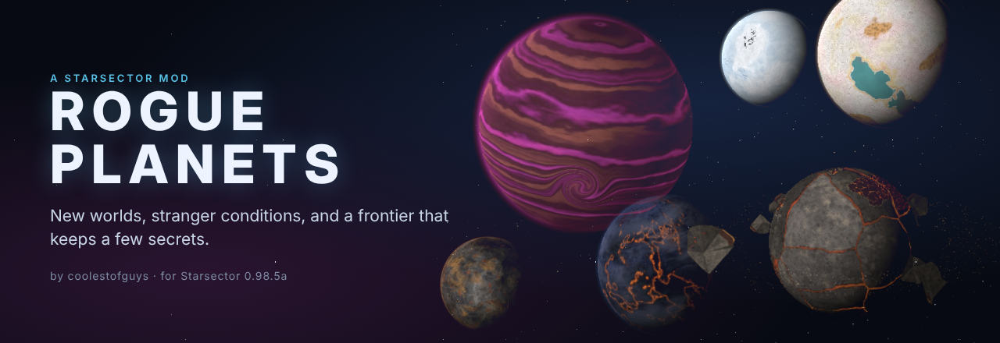
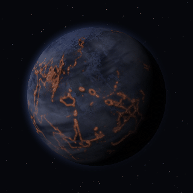
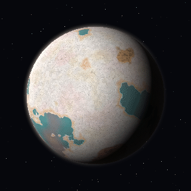
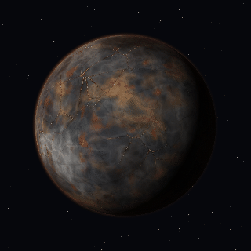
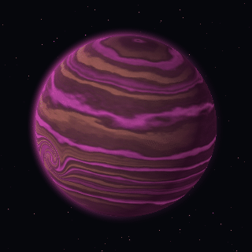
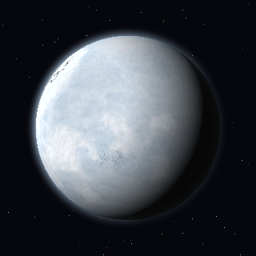
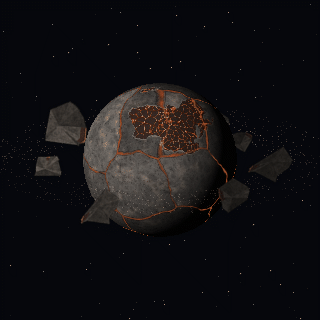
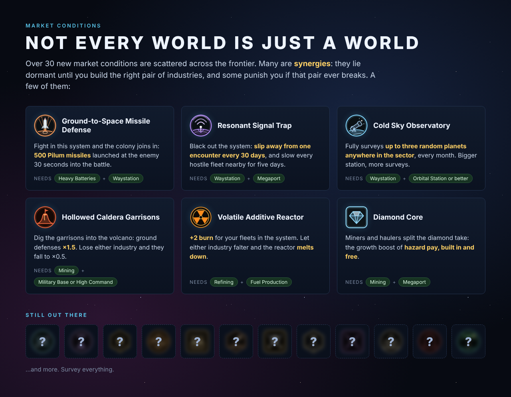
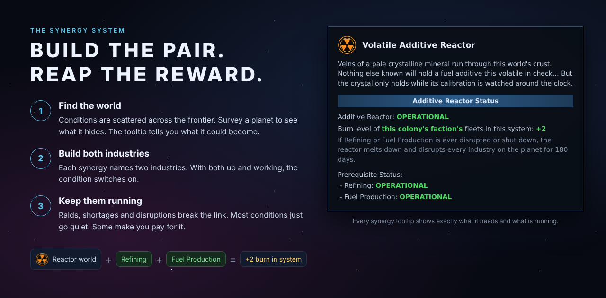

# Rogue Planets

**A Starsector mod by coolestofguys** · for Starsector **0.98.5a** · version **1.0.0**

New kinds of worlds, over thirty new market conditions, and a frontier that keeps a few secrets.

Rogue Planets is built around exploration. This page shows a little of what's out there and deliberately leaves the rest for you to find.

**[Download the latest release](https://github.com/coolestofguys/RoguePlanets/releases/latest)**

---

## New worlds

Six new planet types turn up across the frontier. A few other worlds exist only once in each sector, and we're not showing you those.

| | | |
|:---:|:---:|:---:|
|  **Nocturnal** Dark rogue worlds drifting at the cold edges of empty systems. |  **Halite** The salt-crusted bed of a vanished ocean. Nothing grows here. |  **Chthonian** The bare metal core of a gas giant its star stripped away. Crushing gravity, rich ore. |
|  **Sub-Brown Dwarf** A super-Jupiter that never quite became a star, glowing magenta from its own heat. |  **Snowball** An ocean world frozen pole to pole. The sea is still down there. |  **Sundered** A world broken apart, circled by its own tumbling crust and a field of salvage. |

## Market conditions

Over thirty new conditions are scattered across non-core worlds. Some are simple boons or burdens. Many are **synergies**.

## The synergy system

A synergy condition lies dormant until you build the right **pair of industries** on that world. With both running, it switches on: missile batteries that join your battles, garrisons dug into a volcano, an observatory that maps the sector for you. Let either industry be disrupted and the bonus goes quiet. A few conditions punish you for it.

Hover any condition on a planet to see its full rules and which industries it needs.

## And something else

Some of what's out there isn't on any chart. Keep exploring.

---

## Installation

1. Download the latest release zip and extract it into `Starsector/mods/`, so you end up with `Starsector/mods/RoguePlanets/`.
2. Enable **Rogue Planets** in the launcher.
3. **Start a new campaign.** Worlds and conditions are generated when a sector is created.

No other mods are required.

## Compatibility

- **Starsector 0.98.5a.**
- **Requires a new game.** Adding it to an existing save won't generate the new worlds.
- **Not safe to remove from a save** that has used it.
- Tested alongside **Nexerelin** (AI colonies can settle these worlds), **Unknown Skies** and **Starship Legends**.

## Building from source

The Java source is in `src/`. With a JDK 17+ on your PATH, close the game and run `build.bat` from the mod folder. It compiles against the game in `../../starsector-core` and writes `jars/RoguePlanets.jar`.

## License

[MIT](LICENSE) © 2026 coolestofguys
